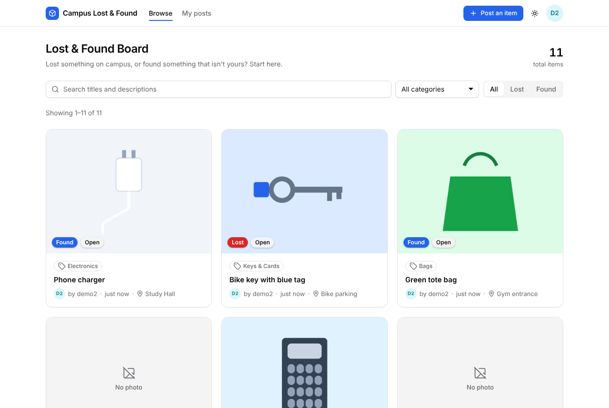
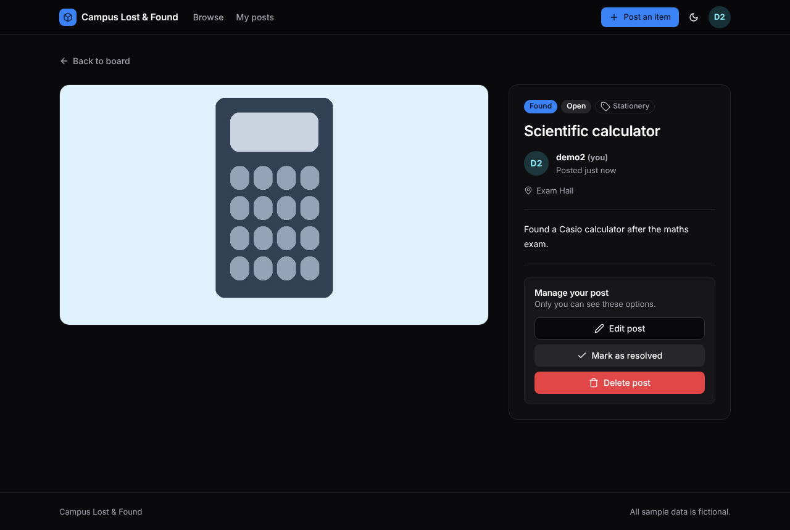
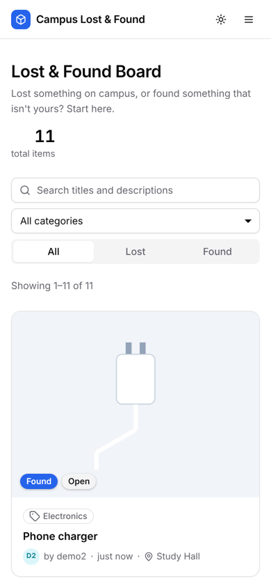

# Campus Lost & Found

A web app for reporting lost and found items on a university campus. Anyone can browse and search the board. Signed-in users can post an item with a photo, then edit it, mark it as resolved or delete it, and nobody else can touch their posts.

Built with Node.js, Express, EJS and MySQL. Pages are rendered on the server and work without JavaScript; a small script adds dark mode, live search, toasts and a few other comforts on top.



| Post detail (dark mode) | Phone |
| --- | --- |
|  |  |

## Features

**Posts**
- Report an item as lost or found, with a category, location, description and one optional photo
- Edit, resolve or delete your own posts from the post page or from **My posts**
- Ownership is enforced on the server. Hiding a button is not the protection: a direct request to edit or delete someone else's post gets a 403

**Finding things**
- Keyword search across titles and descriptions
- Category filter and an All / Lost / Found switch
- Results update as you type (300 ms after you stop)
- 12 posts per page with numbered pages. Page links keep your search and filters, and changing a filter takes you back to page 1

**Accounts**
- Register, log in and log out
- Passwords are hashed with bcrypt. The login error is the same for an unknown user and a wrong password, so the form doesn't reveal which usernames exist
- After logging in you land back on the page you were trying to open

**Photo uploads**
- JPEG or PNG, up to 2 MB, checked in the browser for a quick message and checked again on the server
- The server reads the file's first bytes to confirm it really is a JPEG or PNG, so a renamed text file is rejected
- Files are saved under random names; the uploader's filename is never used

**Interface**
- Light and dark themes. It follows your system setting, and the toggle in the header remembers your choice
- Sticky header and filter bar, a mobile menu, and layouts that adapt from phone to desktop
- Confirmation dialog before deleting, toast messages after actions, spinners on submit buttons
- Relative dates ("3 hours ago") with the exact date on hover
- Empty states and friendly 403, 404 and 500 pages
- Keyboard focus rings, labelled fields, alt text and a skip link

## Tech stack

| Layer | Choice |
| --- | --- |
| Server | Node.js 18+, Express 4 |
| Views | EJS templates, plain CSS with design tokens, a little vanilla JavaScript |
| Database | MySQL 8 (or MariaDB 10.5+) through `mysql2` with a connection pool |
| Auth | `express-session`, `bcryptjs` |
| Uploads | `multer` plus a file-signature check |
| Tests | A smoke test script using Node's built-in `fetch` |

## Getting started

You need Node.js 18 or newer and a MySQL 8 server.

```powershell
git clone https://github.com/<your-username>/campus-lost-and-found.git
cd campus-lost-and-found
npm install
Copy-Item .env.example .env
```

Open `.env` and fill in your MySQL user and password, plus a long random `SESSION_SECRET`.

Create the database with sample data, then start the app:

```powershell
npm run db:setup
npm start
```

Open http://localhost:3000.

If `npm run db:setup` fails because your MySQL user can't create databases, run the two SQL files yourself:

```powershell
cmd /c "mysql -u <user> -p < db\schema.sql"
cmd /c "mysql -u <user> -p < db\seed.sql"
```

Running `schema.sql` again drops and recreates the tables, so it doubles as a reset.

### Demo accounts

The seed script creates two accounts and 11 sample posts. All the data is made up.

| Username | Password |
| --- | --- |
| demo1 | Demo1234! |
| demo2 | Demo1234! |

To add another account from the command line:

```powershell
npm run create-user -- <username> <email> <password>
```

## Project structure

```
app.js                 Express setup, sessions, view helpers, error handlers
db.js                  MySQL connection pool (settings from .env)
routes/auth.js         register, login, logout
routes/items.js        board (search, filters, pages), details, create, edit, resolve, delete, my posts
middleware/            login check, multer upload settings, image signature check
lib/                   relative dates, avatar initials and colours, SVG icons
views/                 EJS templates; views/partials/ holds the shared pieces
public/style.css       design tokens and all styling (light and dark)
public/js/app.js       optional browser enhancements
public/uploads/        uploaded photos (not committed)
db/schema.sql          tables, keys and indexes
db/seed.sql            demo users, categories and posts
scripts/               database setup and create-user helpers
tests/smoke-test.js    automated end-to-end checks
```

## Database

```
users 1 ──< posts >── 1 categories
```

- `posts.user_id` references `users.id` with `ON DELETE CASCADE`, so deleting a user removes their posts.
- `posts.category_id` references `categories.id` with `ON DELETE RESTRICT`, so a category in use can't be deleted.
- `kind` is `lost` or `found` and `status` is `open` or `resolved`, both enforced as `ENUM`s.
- `username` and `email` are unique.

## Security

- Every query that includes user input uses `?` placeholders.
- The server validates every field, every ID in the URL, and that the chosen category exists.
- Edit, resolve and delete load the post and compare its owner with the logged-in user, and the SQL also filters on `user_id`.
- The session ID is regenerated at login; cookies are `httpOnly` and `sameSite=lax`.
- All user text is HTML-escaped by EJS, so it can't inject scripts.
- Errors are logged on the server. Users see a plain message, never a stack trace.

## Testing

Start the app, then in a second terminal:

```powershell
npm run test:smoke
```

It runs 39 checks: registration and duplicates, login, validation, search and filters, pagination, editing and deleting your own posts, a second user being blocked even with hand-made requests, upload type and size limits, and logged-out access. It deletes the posts it creates but leaves two test users behind; `npm run db:setup` resets everything.

[TESTING.md](TESTING.md) lists every scenario with its result, including the browser checks for dark mode, phone layout and the delete dialog.

## Known limitations

- Sessions live in memory, so a server restart logs everyone out. Posts and accounts are safe in MySQL.
- No CSRF tokens. `sameSite=lax` cookies block most cross-site form posts, but tokens would be the complete fix.
- No password reset or email verification.
- Photos are stored on the server's disk in `public/uploads/`.
- The theme choice is saved per browser, not per account.

## License

[MIT](LICENSE)
